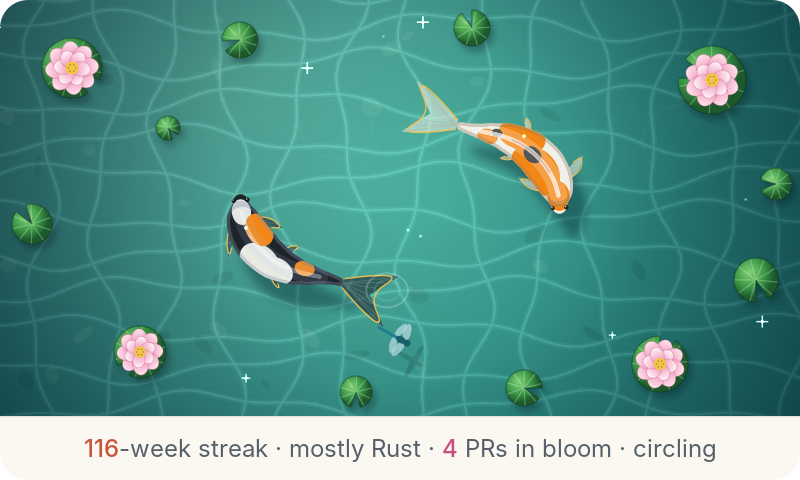

# Git koi

Git koi draws koi from a GitHub account's public activity. Its languages color
them, its contributions grow them, its streaks mark them, and the day that just
ended decides how they swim. A nightly workflow puts them on a profile README as
looping GIFs, the same tool runs from the command line, and the Rust library
underneath is published on crates.io.

This fork adds the pond, now the default: a white koi and a black koi circling a
lily pond as a yin-yang pair, drawn smooth at twice their display size. Each
pull request merged into a repository someone else owns blooms as a lotus. The
season follows the date, with cherry petals, a dragonfly, maple leaves, or ice
and snow, and the dark-theme pond is lit by the moon and fireflies. A caption
names the streak, the main language, the lotus count, and the day's pace.

<picture>
  <source media="(prefers-color-scheme: dark)" srcset="docs/pond-dark.png" />
  
</picture>

The original pixel-art koi is still one option away, as `--style classic`:

<p align="center">
  
</p>

<picture>
  <source media="(prefers-color-scheme: dark)" srcset="docs/bodies-dark.png" />
  
</picture>

## Repository Structure

```text
.
├── .github/      workflows, issue forms, and Dependabot
├── assets/       the caption glyphs, rendered from Inter, and its license
├── docs/         the getting-started guide, the render sheets, and pond samples
├── examples/     the profile workflow and the koi library generator
├── scripts/      the generator for the caption glyphs
├── src/          the library and the git-koi command
├── tests/        the public-boundary tests and their fixtures
└── action.yml    the GitHub Action
```

## Usage

### Requirements

- For a koi on your profile README: a GitHub account. The Action runs in your
  profile repository's workflow with its built-in token.
- For the command line: a binary from the
  [releases page](https://github.com/yalongwastaken/git-koi/releases), or Rust
  at or above the `rust-version` in [Cargo.toml](Cargo.toml), plus the
  [GitHub CLI](https://cli.github.com), authenticated.
- For the library: Rust at or above that same version.

[docs/getting-started.md](docs/getting-started.md) walks through all three: the
Action in a profile workflow, the command line, and the library. The API is
documented on [docs.rs](https://docs.rs/git-koi).

## Author

**Anthony Yalong**

- Email: yalong.anthony123@gmail.com
- GitHub: [@yalongwastaken](https://github.com/yalongwastaken)

## License

MIT. See [LICENSE](LICENSE). The pond's caption glyphs in
`assets/caption-font.bin` are rendered from Inter, under the SIL Open Font
License 1.1; see [assets/OFL.txt](assets/OFL.txt).
